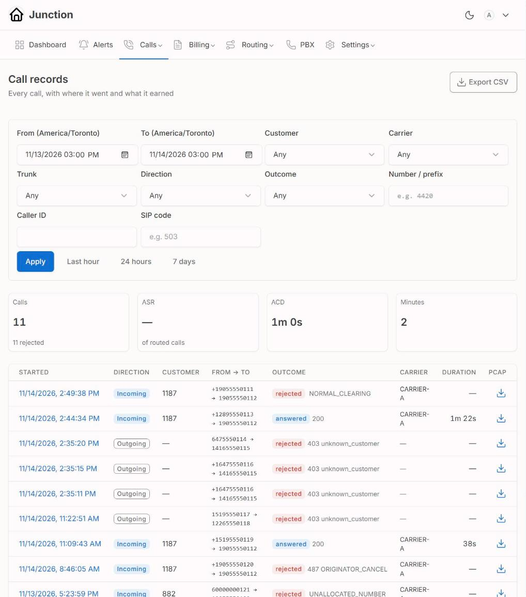
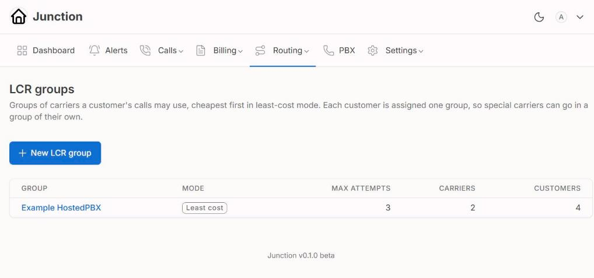

# Junction

**A Class 4 softswitch built on FreeSWITCH.**

Junction is an open Class 4 (wholesale carrier) switch. It routes VoIP traffic between your customers and your carriers using least-cost routing, bills it, and adds a few light PBX features. Everything is managed from a web admin UI, with a customer portal and a REST API.

> **Version 1.1.0.** See [CHANGELOG.md](CHANGELOG.md) for what's included.


## Features

- **Least-cost routing**: route by least cost, priority or weight, with automatic failover between carriers. Carriers that fall below an LCR group's ASR/PDD bar get pushed down the route list.
- **Carriers and rates**: SIP trunks per carrier (IP/FQDN, UDP/TCP/TLS), inbound and outbound call limits, codecs, CSV rate import, and tariffs built from carrier rates plus a markup.
- **Billing (optional)**: prepaid and postpaid customers, credit limits, monthly invoices, billing profiles (per-minute, unlimited Canada/USA, or minute pools), sales taxes for Canada and the US, and carrier payables. You can switch billing off for routing-only use.
- **Light hosted PBX**: extensions, voicemail, IVR, DIDs and a WebRTC browser phone.
- **Monitoring**: live calls, call records with a SIP PCAP for every call, carrier quality stats (ASR, ACD, PDD) and email alerts.
- **Customer portal**: customers see their balance, calls, invoices, rates and API tokens. They never see your carriers or costs.
- **REST API**: bearer tokens, customer-scoped tokens, and an OpenAPI 3.1 spec.
- **High availability**: a live backup server kept in sync with the main one, made the main server with one click.
- **Admin users**: invite people by email with an access level: Owner, Admin, Operations (NOC), Billing or Read-only.
- **Security**: Let's Encrypt SSL, a firewall manager with automatic rollback, fail2ban, and SELinux left in enforcing mode.

## Requirements

- Rocky Linux, AlmaLinux, RHEL or CentOS Stream 9 or 10
- A fresh server with a public IP address
- Root or sudo access

## Install

```sh
git clone https://github.com/key2comm/Junction.git
cd Junction
git checkout "$(git tag -l 'v*' --sort=-v:refname | grep -E '^v[0-9]+\.[0-9]+\.[0-9]+$' | head -n 1)"   # the newest release
sudo ./install.sh
```

When the install finishes, it shows the admin UI address, login and initial password. Open the admin UI at `https://<your-server>/<admin-path>` and sign in with an admin account.

### After installing

1. **Settings → SSL certificate**: get a Let's Encrypt certificate for your hostname.
2. **Settings → Email (SMTP)**: needed for invoices, alerts and portal password links.
3. **Routing → Carriers**: add your carriers and their SIP trunks.
4. **Routing → Carrier rates** and **Tariffs**: import what carriers charge you and build what you charge customers.
5. **Routing → LCR groups**: group your carriers and choose the routing mode.
6. **Billing → Accounts**: add customers and give each one an LCR group and a tariff.

## Update

The dashboard shows **Update available** when there's a newer release on GitHub. To update, run this in the Junction folder on your server:

```sh
cd ~/Junction && sudo ./update.sh
```

It downloads the newest release, checks that it is signed with the Junction release key, and applies it. Your settings, database and call records are kept. To switch to a specific release instead, name it: `sudo ./update.sh v1.1.0`.

**Signed releases.** Every release from v1.0.16 on is a signed git tag. Your server saves the release key in `/etc/softswitch/release-signers` the first time it installs or updates to a version that has one, and from then on refuses any release that isn't signed with it, even if the GitHub repository were taken over. Before a first install you can check a release yourself:

```sh
git -c gpg.format=ssh -c gpg.ssh.allowedSignersFile=release-signers verify-tag v1.1.0
```

and compare the key in `release-signers` with the one published on the release page. `sudo ./update.sh --main` installs the latest unreleased code instead (not signed; for testing only).

Installed v0.1.1 beta or earlier? Those don't have `update.sh` yet, so run `git pull` once first.

## High availability

You can run a second Junction server as a live backup of the main one. The backup keeps a copy of everything, updated continuously:
- the database: customers, carriers, rates, settings, call records and billing;
- files: secrets, certificates, IVR greetings, branding and uploads.

It doesn't take calls itself. If the main server fails, you make the backup the main server with one click, then point your DNS name at it.

### Set it up

Use two servers with the same OS. If they're on the same private network, use their private IPs below.

If your provider has its own firewall in front of the servers (DigitalOcean Cloud Firewalls, AWS security groups and so on), allow TCP port 5432 between the two servers there too, in both directions. Junction's own firewall already allows it, but only for the other server.

1. **On the main server**, add these to `/etc/softswitch/softswitch.conf`, then run `sudo ./install.sh`:
   ```sh
   SS_HA_ROLE="primary"
   SS_HA_PEER="<the backup's IP>"
   ```
   The install ends by printing the settings for the backup, including its `SS_HA_PASSWORD`.
2. **On the backup**, add the printed settings to `/etc/softswitch/softswitch.conf`, then run `sudo ./install.sh`:
   ```sh
   SS_HA_ROLE="standby"
   SS_HA_PEER="<the main server's IP>"
   SS_HA_PASSWORD="<printed by the main server>"
   SS_HOSTNAME="<the same hostname as the main server>"
   ```
   This replaces the backup's own database with a copy of the main server's.

The main server's dashboard shows whether the backup is in sync. If the backup disconnects or falls more than 5 minutes behind, you get an alert. If the backup loses contact with the main server, it emails you.

### If the main server fails

1. Open the backup's admin UI at `https://<backup's IP>` and sign in with your usual login. Click **Make this the main server**, or run `sudo softswitch-ha promote` on the backup.
2. Point your DNS name at the backup's IP. Carriers that whitelist by IP need the backup's IP too, so ask them to add it when you set up HA.
3. When the old main server is back, **don't** start it as the main server again. On it, run `sudo softswitch-ha clone` to make it the new backup.

Calls in progress on the failed server are lost; new calls work once the DNS change takes effect. Run `sudo softswitch-ha status` on either server to see where it stands.

## When something goes wrong

[docs/RUNBOOKS.md](docs/RUNBOOKS.md) has step-by-step fixes for:
- restoring from a backup, onto the same server or a new one;
- failing over to the backup server;
- a firewall lockout;
- an expired certificate;
- FreeSWITCH not starting.

It also sets the recovery targets: at most 1 hour of lost data, and calls flowing again within 1 hour.

## Tour

### Dashboard

The dashboard shows server health and call activity at a glance.

| Field | Description |
|-------|-------------|
| Hostname | The server's host name |
| IP address | The server's primary IP address |
| OS | Operating system name and version |
| Uptime | How long since the server last rebooted |
| App version | The installed version, and whether a newer one is on GitHub |

The CPU, memory and disk figures refresh every 30 seconds.

| Card | What it counts |
|------|----------------|
| Calls in progress | Calls up right now |
| Calls today | Calls since midnight in the server's time zone |
| Calls this month | Calls since the 1st of the current month |
| ASR, last 24 hours | Answer-seizure ratio and average call duration |

Call counts come from the call detail records (CDRs).

### Call records

Filter calls by date, customer, carrier, trunk, direction, outcome, number or SIP code, and export them to CSV. Each call has a detail page and a downloadable SIP PCAP.



### Accounts

Your customers and carriers in one list, with billing type, balance and available funds.


### Carriers

Add each carrier with its currency, time zone, billing and NOC email, inbound and outbound limits, and codecs. Strip leading digits or add a prefix if the carrier needs it.


**Carrier rates**: upload a CSV and match its columns (prefix, destination, rate per minute, minimum and interval). You can also add rates by hand, or delete them all and start over.

**Tariffs**: build customer rates from carrier rates with a markup or a fixed amount per minute, and give different customers different tariffs.

### LCR groups

An LCR group is the set of carriers a customer's calls may use. In least-cost mode the cheapest carrier is tried first. Each customer is assigned one group, so special carriers can go in a group of their own.



### PBX

Extensions, IVRs and DIDs belong to a customer account. Calls from extensions to outside numbers use that account's LCR group, rates and funds. SIP phones register on port 5060, and WebRTC phones connect over `wss://<your-server>/ws`.


### Customer portal

Customers sign in at the same address and land in `/portal`. Add portal logins from the customer's account page. If email is set up, the customer gets a link to set their password.

### REST API

Create a token in **Settings → API tokens**, then call `https://<your-server>/api/v1/...` with `Authorization: Bearer ss_…`. The OpenAPI 3.1 spec is at `/api/v1/openapi.json`. Customer-scoped tokens only see that customer's account, calls and invoices.

```sh
curl -H "Authorization: Bearer $TOKEN" https://switch.example.com/api/v1/cdrs/summary
```

## Known limitations

- High availability is one main server plus one backup, with manual failover. Calls in progress are lost on a failover, and moving traffic needs a DNS change.
- Call captures cover SIP on ports 5060 and 5080 only. TLS (5061) and WebRTC (WSS) signalling is encrypted, so it can't be captured.
- The web phone needs UDP ports 16384–32768 open to the browser.

## Changelog

See [CHANGELOG.md](CHANGELOG.md).
