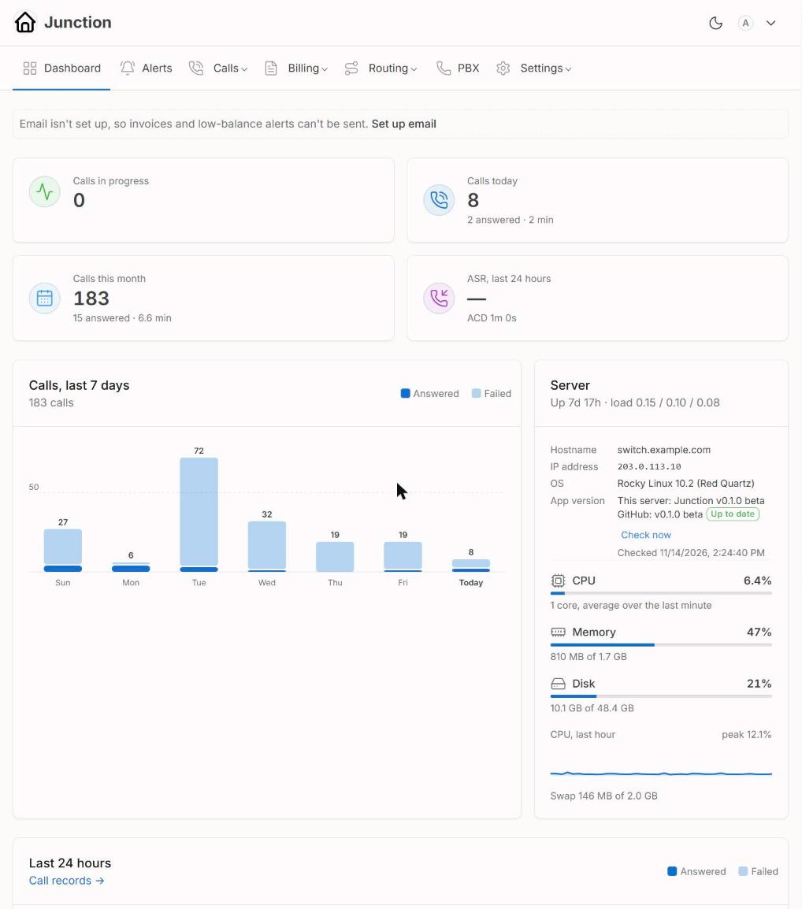
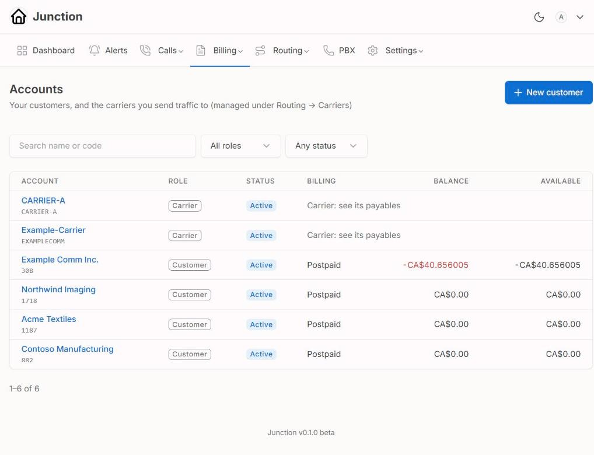
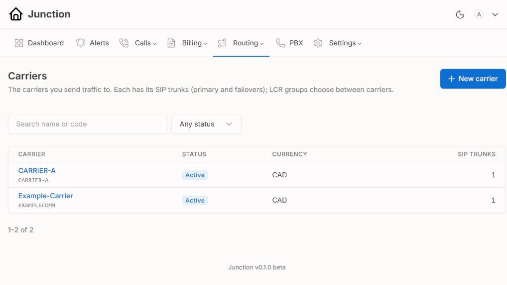
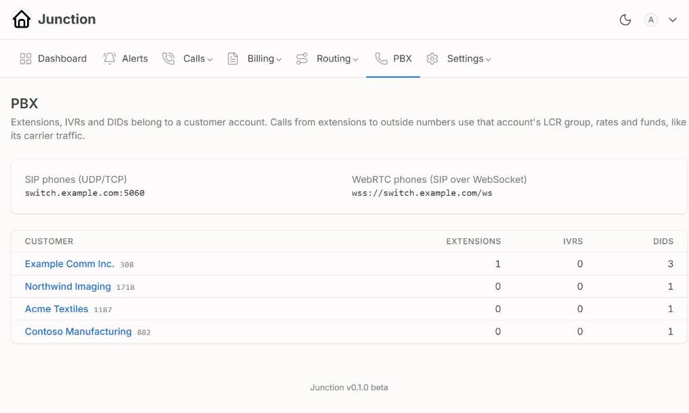

# Junction

**A Class 4 softswitch built on FreeSWITCH.**

Junction is an open Class 4 (wholesale carrier) switch. It routes VoIP traffic between your customers and your carriers using least-cost routing, bills it, and adds a few light PBX features. Everything is managed from a web admin UI, with a customer portal and a REST API.

> **Status: v0.1.1 beta.** Test it on your own traffic before relying on it, and expect changes before 1.0. See [CHANGELOG.md](CHANGELOG.md) for what's included.



## Features

- **Least-cost routing**: route by least cost, priority or weight, with automatic failover between carriers. Carriers that fall below an LCR group's ASR/PDD bar get pushed down the route list.
- **Carriers and rates**: SIP trunks per carrier (IP/FQDN, UDP/TCP/TLS), inbound and outbound call limits, codecs, CSV rate import, and tariffs built from carrier rates plus a markup.
- **Billing (optional)**: prepaid and postpaid customers, credit limits, monthly invoices, billing profiles (per-minute, unlimited Canada/USA, or minute pools), sales taxes for Canada and the US, and carrier payables. You can switch billing off for routing-only use.
- **Light hosted PBX**: extensions, voicemail, IVR, DIDs and a WebRTC browser phone.
- **Monitoring**: live calls, call records with a SIP PCAP for every call, carrier quality stats (ASR, ACD, PDD) and email alerts.
- **Customer portal**: customers see their balance, calls, invoices, rates and API tokens. They never see your carriers or costs.
- **REST API**: bearer tokens, customer-scoped tokens, and an OpenAPI 3.1 spec.
- **Security**: Let's Encrypt SSL, a firewall manager with automatic rollback, fail2ban, and SELinux left in enforcing mode.

## Requirements

- Rocky Linux, AlmaLinux, RHEL or CentOS Stream 9 or 10
- A fresh server with a public IP address
- Root or sudo access

## Install

```sh
git clone https://github.com/key2comm/Junction.git
cd Junction
sudo ./install.sh
```

When the install finishes, open the admin UI at `https://<your-server>/<admin-path>` and sign in with an admin account.

### After installing

1. **Settings → SSL certificate**: get a Let's Encrypt certificate for your hostname.
2. **Settings → Email (SMTP)**: needed for invoices, alerts and portal password links.
3. **Routing → Carriers**: add your carriers and their SIP trunks.
4. **Routing → Carrier rates** and **Tariffs**: import what carriers charge you and build what you charge customers.
5. **Routing → LCR groups**: group your carriers and choose the routing mode.
6. **Billing → Accounts**: add customers and give each one an LCR group and a tariff.

## Tour

### Dashboard

The dashboard shows server health and call activity at a glance.

| Field | Description |
|-------|-------------|
| Hostname | The server's host name |
| IP address | The server's primary IP address |
| OS | Operating system name and version |
| Uptime | How long since the server last rebooted |
| App version | The installed version, and whether a newer one is on GitHub |

The CPU, memory and disk figures refresh every 30 seconds.

| Card | What it counts |
|------|----------------|
| Calls in progress | Calls up right now |
| Calls today | Calls since midnight in the server's time zone |
| Calls this month | Calls since the 1st of the current month |
| ASR, last 24 hours | Answer-seizure ratio and average call duration |

Call counts come from the call detail records (CDRs).

### Call records

Filter calls by date, customer, carrier, trunk, direction, outcome, number or SIP code, and export them to CSV. Each call has a detail page and a downloadable SIP PCAP.


### Accounts

Your customers and carriers in one list, with billing type, balance and available funds.



### Carriers

Add each carrier with its currency, time zone, billing and NOC email, inbound and outbound limits, and codecs. Strip leading digits or add a prefix if the carrier needs it.



**Carrier rates**: upload a CSV and match its columns (prefix, destination, rate per minute, minimum and interval). You can also add rates by hand, or delete them all and start over.

**Tariffs**: build customer rates from carrier rates with a markup or a fixed amount per minute, and give different customers different tariffs.

### LCR groups

An LCR group is the set of carriers a customer's calls may use. In least-cost mode the cheapest carrier is tried first. Each customer is assigned one group, so special carriers can go in a group of their own.


### PBX

Extensions, IVRs and DIDs belong to a customer account. Calls from extensions to outside numbers use that account's LCR group, rates and funds. SIP phones register on port 5060, and WebRTC phones connect over `wss://<your-server>/ws`.



### Customer portal

Customers sign in at the same address and land in `/portal`. Add portal logins from the customer's account page. If email is set up, the customer gets a link to set their password.

### REST API

Create a token in **Settings → API tokens**, then call `https://<your-server>/api/v1/...` with `Authorization: Bearer ss_…`. The OpenAPI 3.1 spec is at `/api/v1/openapi.json`. Customer-scoped tokens only see that customer's account, calls and invoices.

```sh
curl -H "Authorization: Bearer $TOKEN" https://switch.example.com/api/v1/cdrs/summary
```

## Known limitations

- Single server only. There is no clustering or high availability yet.
- Call captures cover SIP on ports 5060 and 5080 only. TLS (5061) and WebRTC (WSS) signalling is encrypted, so it can't be captured.
- The web phone needs UDP ports 16384–32768 open to the browser.

## Changelog

See [CHANGELOG.md](CHANGELOG.md).
