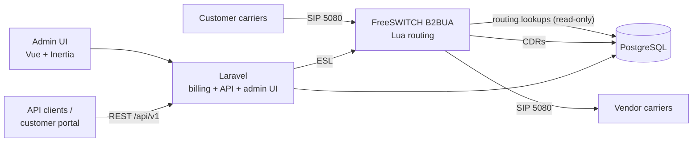

# Softswitch build plan

A Class 4 softswitch routes and manages high-volume long-distance and international VoIP traffic between wholesale carriers, aggregators, and service providers. This one runs on FreeSWITCH and adds a small set of PBX features on the side.

## Concepts

- **Customer (ingress carrier):** sends us traffic and is billed by the minute. Authenticated by IP, with optional tech-prefix.
- **Vendor (egress carrier):** we send traffic to them and pay their rate deck. Reached through FreeSWITCH gateways.
- **Rate deck:** per-prefix price list. There's one for each vendor (buy) and one for each customer (sell).
- **LCR:** for each call, match the longest prefix against vendor decks, rank by cost (plus quality and priority), then try the vendors in order on failure codes.
- **Controls:** limits on calls per second (CPS) and concurrent channels for each customer and vendor, a margin check (never sell below cost), blocked prefixes, and maximum call duration.
- **Quality stats:** ASR (answer rate), ACD (average call length), and PDD (post-dial delay), tracked per vendor and per route, and used to steer routing.
- **CDRs:** one record for each call attempt, holding both the customer leg and the vendor leg, rated at both buy and sell prices.
- **Topology hiding:** customers and vendors never see each other's IPs or headers. FreeSWITCH, acting as a back-to-back user agent (B2BUA), does this naturally.

## Capacity note

FreeSWITCH relays every call's media (RTP). The current 1 vCPU droplet is for building and testing only, and handles roughly 30–50 calls without transcoding. Production needs a larger server, or several media servers behind a Kamailio SIP proxy. That's revisited after phase 3.

## Test server

| | |
|---|---|
| Host | `theswitch.key2pbx.ca` (SSH alias `theswitch`, user `rocky`) |
| Public IP | 147.182.148.63 (DigitalOcean droplet), VPC 10.137.0.15 |
| OS | Rocky Linux 10.2 |
| Size | 1 vCPU, 1.7 GB RAM, 49 GB disk |

## Port layout

| Port | Purpose | Who can reach it |
|---|---|---|
| 22/tcp | SSH (keys only) | anywhere, rate-limited and covered by fail2ban |
| 80, 443/tcp | nginx: Let's Encrypt, admin UI, WSS proxy | anywhere |
| 5080/udp+tcp | FreeSWITCH `carrier` profile: **all wholesale traffic** from customers and vendors, IP-authenticated | **only IPs in the `carriers` set** |
| 5060/udp+tcp, 5061/tls | FreeSWITCH `internal` profile: PBX phones only, digest auth | anywhere, covered by fail2ban |
| 7443 | FreeSWITCH WSS, proxied by nginx `/ws` | localhost only |
| 16384-32768/udp | RTP media | anywhere |
| 9090 | Cockpit | closed |

## Architecture

- **The call path never waits on PHP.** FreeSWITCH's Lua routing reads PostgreSQL directly, using cached prepared queries, so calls keep routing even if the web app is down or slow.
- **Laravel is the system of record.** It owns every write (carriers, rates, routes, balances), billing, the API, and the admin UI.
- **One API, two consumers.** The admin UI and outside API clients use the same domain logic. Inertia pages and the REST controllers call the same services.

## Billing

- **Accounts:** a company can be a customer, a vendor, or both. Customers are prepaid or postpaid, with a credit limit, currency, and time zone.
- **Rating:** rate decks are versioned with effective dates (increases need notice; decreases apply immediately). Each rate has its own billing increments (60/60, 6/6, 1/1), a minimum duration, and a connection fee. Every CDR is rated twice, at sell (customer) and buy (vendor) prices, which gives the margin per call.
- **Real-time enforcement:** at call setup, Lua checks the customer's available balance (balance + credit − amount reserved by calls in progress), works out the maximum call duration at the sell rate, and schedules a hangup at that point. A blocked prefix, a below-cost margin, or no funds rejects the call with a configurable SIP code.
- **Money flow:** balances, payments, and manual adjustments are recorded in an immutable ledger. Invoices are generated per billing cycle as PDF and CSV. Vendor invoices are reconciled against our CDRs later.

## LCR

- Longest-prefix match against each vendor's current rate deck, filtered by the customer's routing plan (allowed vendors, route classes such as premium/standard/CLI).
- Vendors ranked by cost, then priority or weight, and adjusted by quality (ASR/ACD/PDD). Static overrides are available (fixed order, load-balance percentages, blocked vendors per prefix).
- Failover to the next vendor on configurable SIP codes (503/502/408/480 and others), with a maximum number of attempts and a time budget. 486 (busy) and 404 (not found) are final and don't trigger failover.
- Every attempt is logged so "why did this call go to vendor X" can be answered from the CDR.

## API

- Versioned REST API at `/api/v1` (Laravel). Authentication with Sanctum tokens; scopes separate admin access from customer-portal access.
- Resources: accounts, carrier IPs and gateways, rate decks (including CSV import), routing plans, CDRs (filter and export), balances and payments, invoices, live calls, and stats.
- An OpenAPI spec is generated from the code and published with the docs. Webhooks (low balance, gateway down, rate import finished) come later.

## Phases

1. **Harden the host** (done on the test server): nftables firewall, fail2ban, SSH key-only.
2. **FreeSWITCH** (building): from public source with no SignalWire token. Replace the stock config with a Softswitch config that has two profiles (`carrier` on 5080, `internal` on 5060) and the event socket on localhost.
3. **Data model and Laravel skeleton** (done): schema, rating, ledger, and admin pages for accounts, rate decks (CSV import), trunks and gateways, and routing plans. PostgreSQL install step. Laravel + Vue + Inertia app under `/var/www/html`, with nginx, PHP-FPM, and Let's Encrypt. Migrations for accounts, IPs, gateways, rate decks, routing plans, CDRs, and the ledger. Admin login.
4. **Routing engine** (done; the built-in self-test passes on the live switch): routing in PostgreSQL functions shared by FreeSWITCH and the route tester, route.lua, the Softswitch FreeSWITCH config, CDR ingestion and rating, usage posting, and gateway and firewall sync. Lua dialplan with customer identification by source IP (and tech-prefix), number normalization, LCR, failover, CPS and channel limits, balance checks, and maximum duration. FreeSWITCH gateways and the firewall `carriers` set generated from the database.
5. **Billing** (done: per-call rating, usage posting in 15-minute batches, call records page, monthly invoices per customer time zone, vendor payables and vendor invoice reconciliation, SMTP settings in the admin UI, low-balance alerts, invoice emailing, dashboard): CDRs into PostgreSQL, rating, ledger, invoices, rate deck import with effective dates.
6. **API** (done: /api/v1, 37 operations, bearer tokens with abilities and customer scoping, OpenAPI 3.1 at /api/v1/openapi.json, customer portal at /portal): `/api/v1` with token scopes and OpenAPI docs. A customer portal built on the same API.
7. **Quality and operations** (next): ASR/ACD/PDD stats, alerts, live calls view, and dashboards.
8. **Minimal PBX:** extensions, voicemail, simple IVR, and WebRTC through nginx WSS, with outbound calls routed through LCR.

## Deploy model

The project ships as an installer (`install.sh` plus `installer/steps/`), so anyone can install it on their own EL9/EL10 server. `deploy/` holds the config templates; `@SS_VAR@` placeholders are filled in from `/etc/softswitch/softswitch.conf`. Nothing is hand-edited on servers. Change the repo and re-run the installer.

FreeSWITCH is built from public source (signalwire/freeswitch, freeswitch/sofia-sip, freeswitch/spandsp). No SignalWire token or paid repo is needed.

## Later

- STIR/SHAKEN signing and verification (needed for North American carriers; FreeSWITCH supports it through libstirshaken).
- Support more operating systems (Debian/Ubuntu).
